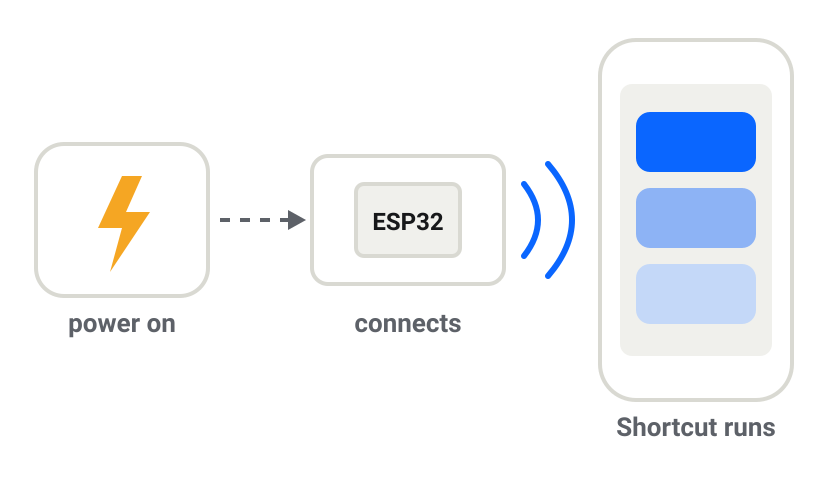

# ESP32 BT Trigger

**When it powers on, your iPhone runs a Shortcut.**

<p align="center">
  <a href="https://mattboxx.github.io/esp32-bt-trigger/">
    
  </a>
</p>

A tiny open-source firmware that turns a $3 ESP32 board into a **Bluetooth trigger
for iPhone Shortcuts automations**. No app on the phone, no Wi-Fi, no cloud, no NFC
tag to tap. Power it up → it connects → iOS runs your automation.

[](https://github.com/Mattboxx/esp32-bt-trigger/actions/workflows/firmware.yml)
[](LICENSE)
[](https://ko-fi.com/mattboxx)

### ⚡ [Install it from your browser →](https://mattboxx.github.io/esp32-bt-trigger/)

Plug the board into your computer, pick a name and options, click **Install**.
Two minutes, nothing to install, no code to edit. (Chrome or Edge on a computer.)

---

## What you can do with it

| Power it from… | …and your iPhone automatically… |
|---|---|
| 🛴 Scooter, e-bike, car ignition | opens navigation / your dashboard app, starts a ride timer |
| 🖥️ Desk lamp, monitor, USB hub | turns on the *Work* Focus, starts a playlist |
| 🖨️ 3D printer, workshop tools | starts a timer, logs the session, notifies you |
| 🚪 Reed switch on a door *(switch mode)* | sends you a notification, calls a webhook |
| 🔘 A push button *(pulse mode)* | runs any shortcut with one press |
| 🏠 Anything | calls **Home Assistant**, HomeKit scenes or webhooks via Shortcuts |

It's the missing *"when this turns on, do that on my phone"* building block.

## Two ways to trigger it

| | ⚡ **When it gets power** | 📍 **When a pin is activated** |
|---|---|---|
| Connects when… | the board gets power | a pin you choose is active (switch) or pressed (button) |
| Wiring | none: power it from what you want to detect | a switch / relay / button / sensor on any GPIO |
| Typical use | scooter, car, lamp, monitor, 3D printer | door reed switch, push button, alarm or relay output |

One firmware does both: pick the mode in the web installer, and change it later with
**Save settings only**. With a pin trigger the board stays visible until a phone is paired,
so you can pair it before wiring anything.

## Why not just an ESP32 with Wi-Fi and Home Assistant?

A Wi-Fi ESP32 + Home Assistant is great for flipping switches and logging data **at
home**. This project does two things that setup can't:

- **It acts on the phone itself.** Wi-Fi + HA can control your house, but it can't
  open Maps, turn on a Focus, start a timer, set the volume or run any Shortcut *on
  your iPhone*. This triggers the phone directly — that's the point.
- **It works with no network.** On a scooter, bike or car there's no home Wi-Fi and
  no SIM, so a Wi-Fi ESP32 is offline the moment you leave. This one talks to the
  phone in your pocket over Bluetooth, and **the phone** is the gateway to the
  internet (and to HA, over mobile data).
- **Nothing to run or install.** No HA server, no companion app, no account, no
  cloud — just the board and the built-in Shortcuts app.

A Wi-Fi ESP32 sends data *to a server*; this sends an event *to the phone you carry*,
wherever you are. They also combine: the Shortcut can still call Home Assistant.

## How it works

The ESP32 presents itself to the iPhone as a **Bluetooth mouse that never moves**.
The Shortcuts app can run an automation *"When &lt;device&gt; is connected"* (or
*disconnected*). The act of **connecting** is the trigger. Nothing is ever typed or
clicked.

- **Why a mouse?** iOS only lets you pair a few device types from Settings (audio,
  keyboards, mice, controllers). Plain BLE beacons never appear in the list, so they
  can't trigger Shortcuts. A *keyboard* would hide your on-screen keyboard while
  connected. A mouse has no side effect (at most an AssistiveTouch pointer).
- **Why Classic Bluetooth?** Bluetooth LE (GATT) HID accessories do pair with the
  iPhone, but iOS Shortcuts doesn't list them as automation triggers (we tested it
  with an ESP32-S3). Only Classic Bluetooth accessories show up, so this needs the
  original ESP32.
- **Reconnects by itself.** After a reboot or a dropped link the board calls back
  the last paired iPhone, then any other paired phone.

## Compatibility

| Chip | Works? | Why |
|---|---|---|
| **ESP32** (original): DevKit, DOIT DevKit V1, NodeMCU-32S, WROOM-32, WROVER, PICO-D4, D1 mini32, M5 Atom, ESP32-CAM, TTGO… incl. single-core & 26 MHz crystal variants | ✅ Yes | Classic Bluetooth HID. Approach tested on iPhone (v1); v2 rewrite being verified |
| ESP32-S3, ESP32-C3, ESP32-C6, ESP32-C5, ESP32-H2, ESP32-C2 | ❌ No | Bluetooth LE only: they pair, but iOS Shortcuts doesn't list them as triggers (tested with an ESP32-S3) |
| ESP32-S2, ESP8266 | ❌ No | No Bluetooth |

Any flash size **from 2 MB** works. Buying one? Look for **"ESP32 DevKit"** or
**"ESP32-WROOM-32"** (about $3–5), not S3/C3/C6. Tested it on a board not listed here?
[Open a hardware report](https://github.com/Mattboxx/esp32-bt-trigger/issues/new?template=hardware-report.yml),
even if it's just "works on my DevKit".

## Settings (no code to edit)

Everything is set in the [web installer](https://mattboxx.github.io/esp32-bt-trigger/).
Connect the board again later: your settings are read back, and **Save settings only**
rewrites them in a second without touching the pairing.

| Setting | What it does |
|---|---|
| **Bluetooth name** | What you'll see in iPhone Settings and in Shortcuts (up to 29 bytes). |
| **Trigger** | **Power**: connect whenever powered. **Pin, switch**: connected while the input pin is active (reed switch, relay). **Pin, button**: a press connects for N seconds, then disconnects. |
| **Input pin** *(pin trigger)* | Any safe GPIO of your chip (flash pins are hidden). |
| **Active level** *(pin trigger)* | Triggered when the pin reads **LOW** or **HIGH**. |
| **Internal resistor** *(pin trigger)* | **Pull-up**, **pull-down** or **none** (for sensor/relay outputs that drive the pin, or an external resistor). The installer explains the wiring and warns about combinations that would float or stay always on. |
| **Debounce** *(pin trigger)* | Ignore glitches shorter than N ms (10–5000, default 50). Raise it for bouncy reed switches or relays. |
| **Keep connected after release** *(switch)* | Stay connected N seconds after the pin goes idle, so a door that opens and closes quickly still fires. |
| **Duration** *(button)* | How long each press keeps the iPhone connected (default 10 s; under ~3 s the iPhone may not finish connecting). |
| **Status LED** | None, normal LED or RGB (WS2812/SK6812). Fast blink = ready to pair, slow blink = looking for the iPhone, solid = connected. |
| **"Forget phones" button** | Hold 5 s to wipe every pairing (default: the BOOT button). |
| **Transmit power** | Default, or a fixed level in dBm (ESP32 levels: −12 to +9 dBm, 3 dB steps). Lower = shorter range and less power, higher = better through boxes and metal. |
| **Pairing window** | Only accept *new* phones in the first 60 s / 3 min after power-on, so strangers can't see or pair it. Paired phones always reconnect. |
| **Board preset** | Pre-fills LED and button pins for 20+ popular boards. |

## Quick start

1. **Flash:** open the [web installer](https://mattboxx.github.io/esp32-bt-trigger/), click **Connect**, choose your settings, click **Install**.
2. **Pair (once):** iPhone → **Settings → Bluetooth** → tap your device under *Other Devices*. No PIN.
3. **Automate:** **Shortcuts → Automation → + → Bluetooth** → choose your device →
   **Is Connected** → **Run Immediately** → add your actions.

Every time the board powers up (or the switch/button fires) and connects, the automation runs.

<details>
<summary><b>Flash without the browser (esptool)</b></summary>

Download the file for your chip from [`firmware/`](firmware) or the
[Releases](https://github.com/Mattboxx/esp32-bt-trigger/releases)
page. Each file is a merged image written at `0x0`:

```bash
pip install esptool
```

```bash
esptool.py --port <PORT> write_flash 0x0 bt-trigger-esp32.factory.bin
```

Default settings apply: name `ESP32-BT-Trigger`, connects whenever powered, LED on GPIO2 (ESP32).
For a pin trigger, connect the board to the web installer afterwards and use **Save settings only**.
See [`firmware/README.md`](firmware/README.md).
</details>

<details>
<summary><b>Build from source (PlatformIO)</b></summary>

```bash
pio run -e esp32
```

```bash
pio run -e esp32 -t upload && pio device monitor
```

```bash
python scripts/make_release.py    # all variants + merged images + manifest
```

ESP-IDF 5.3.1 is used (not Arduino): the Classic BT *HID Device* role is disabled in
the precompiled Arduino libraries. The first build downloads the SDK and is slow.
</details>

## Troubleshooting

- **Not in the Bluetooth list:** the device is probably already paired to another
  phone or the pairing window has closed. Power-cycle it, or hold the reset button 5 s.
- **Paired but the automation doesn't run:** in Shortcuts, make sure the automation
  is set to **Run Immediately** and the device is selected in the Bluetooth trigger.
- **After re-flashing it won't connect:** on the iPhone tap the device → *Forget This
  Device*, then pair again (needed whenever the board's pairings were wiped or the name changed).
- **Logs:** the web installer has a *Show live device log* button, or use
  `pio device monitor` at 115200 baud. Red `BT_BTM` / `BT_HCI` lines are normal bluedroid noise.

## Project layout

| Path | Purpose |
|---|---|
| `src/main.c` | Trigger modes, reset button, pairing window, status LED |
| `src/transport_classic.c` | Classic Bluetooth HID mouse + active reconnect (ESP32) |
| `src/config.c` | Reads settings from the `btcfg` flash partition |
| `partitions.csv` | 2 MB layout with the 4 KB `btcfg` settings partition at `0x180000` |
| `docs/` | Website + web installer (GitHub Pages) |
| `test/host/` | Runs the real firmware settings parser against the web installer's output |
| `scripts/make_release.py` | Builds every variant and the merged images |

## Support the project

It's free, MIT licensed, with no paid features, and it will stay that way. A commercial
smart button costs $30–40 and needs its own app. If this saved you that, you can help pay
for new test boards and iOS update testing:

[](https://ko-fi.com/mattboxx)
[](https://github.com/sponsors/Mattboxx)

Not in a position to donate? A ⭐ or a hardware test report in the
[issues](https://github.com/Mattboxx/esp32-bt-trigger/issues) helps just as much.

## License

MIT, see [LICENSE](LICENSE). The web installer bundles
[esptool-js](https://github.com/espressif/esptool-js) (Apache-2.0).
Not affiliated with Apple or Espressif.
